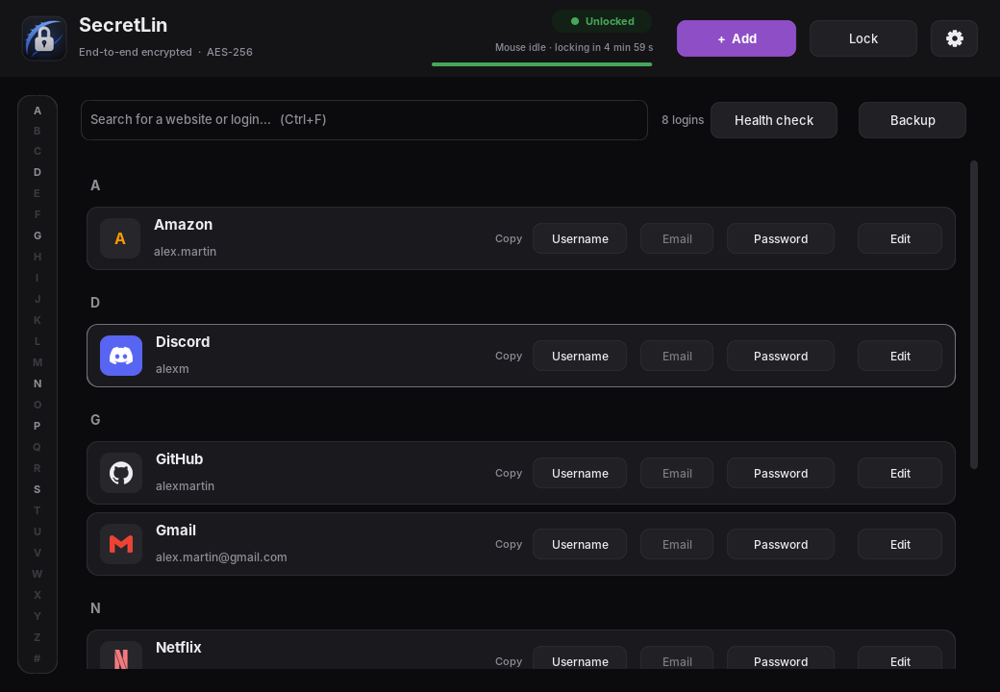
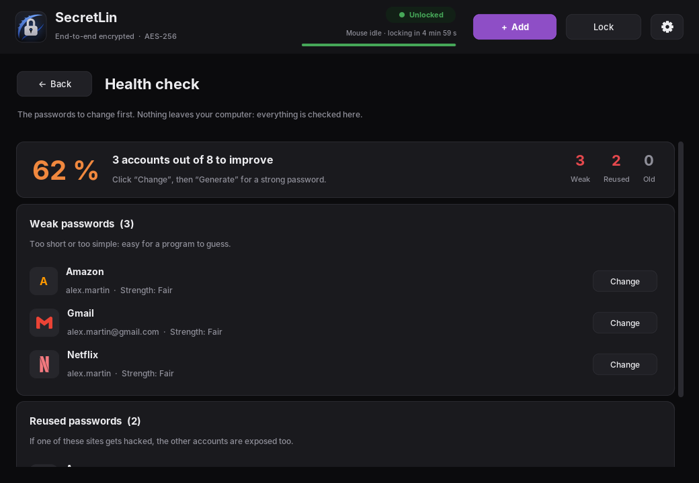
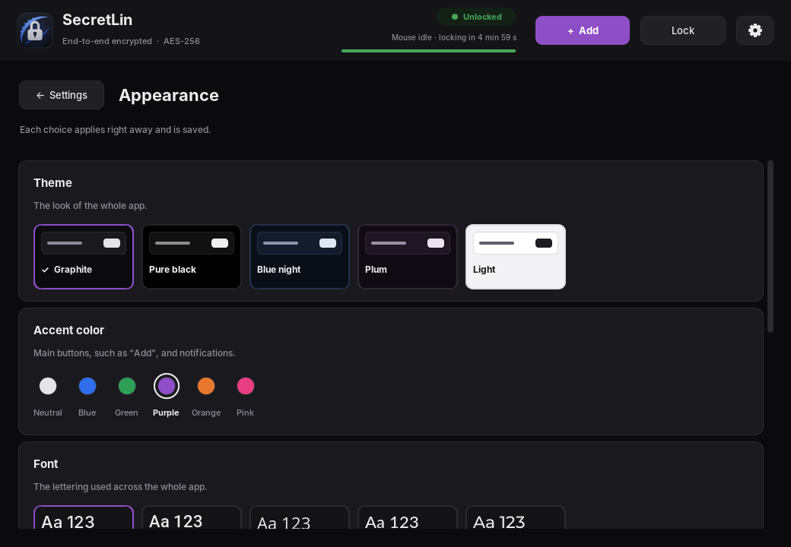
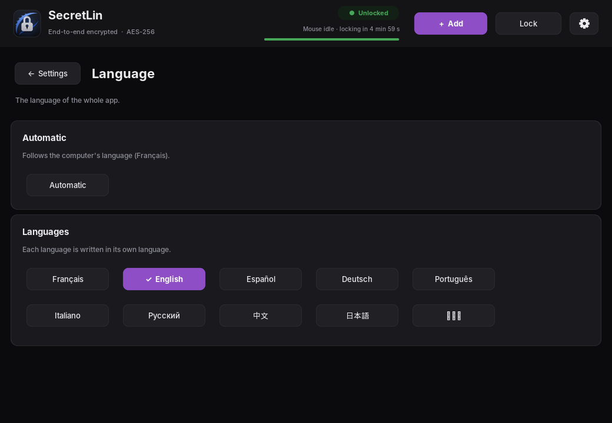

<div align="center">

# 🔐 SecretLin

**A simple, good-looking, encrypted password manager for Linux.**

🇫🇷 [Français](README.md) · 🇬🇧 English

[](https://github.com/peterpan1-sudo/SecretLin/releases/latest)
[](LICENSE)




</div>

SecretLin keeps all your logins (website, username, email, password) in an **encrypted
vault** on your computer. You only need to **remember one password**: the master
password. Nothing is sent over the Internet.

## Contents

- [Features](#-features)
- [Installation](#-installation)
- [Getting started](#-getting-started)
- [Screenshots](#-screenshots)
- [Security](#-security)
- [Backups](#-backups)
- [FAQ](#-faq)
- [For developers](#-for-developers)
- [Credits and licence](#-credits-and-licence)

## ✨ Features

| | |
|---|---|
| 🔒 **Encrypted vault** | AES-256-GCM, key derived from the master password with Argon2id. |
| 📋 **One-click copy** | Username, email or password; the clipboard is cleared after 3 minutes. |
| 🎲 **Generator** | Strong passwords: length, uppercase, digits, symbols, no look-alike characters. |
| 🩺 **Health check** | Finds weak passwords, reused ones, ones not changed for over a year and, optionally, ones found in data breaches. |
| 🔑 **2FA codes** | Six-digit two-factor authentication codes, like Google Authenticator. |
| ⭐ **Favourites and categories** | Favourite accounts at the top of the list, categories (Games, Banking…) and a filter. |
| 🕘 **History** | The last 10 passwords of each account can still be viewed. |
| 📦 **Import** | From Firefox, Chrome, Bitwarden, KeePass, 1Password or LastPass (CSV file). |
| 🔎 **Search and A–Z index** | Find an account in a few keystrokes. Logos for well-known sites (Discord, Netflix, Steam…). |
| ⏱️ **Auto-lock** | After 5 min without moving the mouse over the window, or 2 min with the mouse outside it. |
| 💾 **Backups** | Automatic copies, encrypted export and import (USB stick, another drive…). |
| 🎨 **Customisable** | 5 themes, 6 colours, 10 fonts, text size, animations. |
| 🌍 **10 languages** | French, English, Spanish, German, Portuguese, Italian, Russian, Chinese, Japanese, Korean. |

## 📥 Installation

SecretLin is made for **Kali Linux** and **Debian** (`.deb` package).

### First install

1. Open the [latest release](https://github.com/peterpan1-sudo/SecretLin/releases/latest) page.
2. Download the **3 `.deb` files** (SecretLin and two libraries that are not in the Kali repositories).
3. Open a terminal in the download folder, then run:

   ```bash
   cd ~/Downloads
   sudo apt install ./python3-darkdetect_*_all.deb ./python3-customtkinter_*_all.deb ./secretlin_*_all.deb
   ```

4. Start SecretLin from the **applications menu**, or type `secretlin` in a terminal.

The interface fonts, including the Chinese, Japanese and Korean ones, are installed automatically with SecretLin.

### Updating

Each release page gives a ready-to-copy command, for example:

```bash
cd /tmp && wget -N https://github.com/peterpan1-sudo/SecretLin/releases/download/v1.2.0/secretlin_1.2.0_all.deb && sudo apt install ./secretlin_1.2.0_all.deb
```

Your vault and settings are kept.

## 🚀 Getting started

1. **Create your master password** on first launch. Make it long and write it down
   somewhere safe: without it, the vault cannot be opened.
2. Click **“+ Add”** to save an account. The **“Generate”** button creates a strong
   password for you.
3. In the list, the **“Copy”** buttons copy the username, email or password.
4. Open the **“Health check”** from time to time to see which passwords to change.
5. The **⚙** gear opens the settings: security, generator, appearance and language.

**Keyboard shortcuts:** `Ctrl+N` add · `Ctrl+F` search · `Ctrl+L` lock.

## 📸 Screenshots

| Health check | Appearance |
|---|---|
|  |  |

| Language | |
|---|---|
|  | |

## 🔒 Security

- The vault is encrypted with **AES-256-GCM**. The key is derived from the master password
  with **Argon2id**, which is designed to make guessing attacks very slow.
- The master password is **never stored** anywhere. It must be at least 12 characters long
  (lowercase, uppercase, digit, special character), and SecretLin checks that it does not
  appear in a known data breach (the box can be unticked).
- Optional **key file** (⚙ Settings → Security): the vault then only opens with the master
  password **and** a file, for example on a USB stick. It is a second factor: a stolen
  password is no longer enough.
- Any change to the vault file (by another program, for example) is **detected**.
- After 3 wrong attempts you must wait 1 min, then 3, 5, 10, 15, 30 min and 1 h.
  The wait continues even if SecretLin is closed and reopened.
- The **Health check** analyses your passwords on the computer.
- The **data breach** check (Have I Been Pwned) is **off by default**. When it is on, your
  passwords are still never sent: only the first 5 characters of their SHA-1 fingerprint
  go over the Internet, and the comparison happens on the computer (“k-anonymity”).

## 💾 Backups

The vault is stored in `~/.local/share/GestionnaireMDP/coffre.vault`.
SecretLin also keeps copies of it, all encrypted:

- before each save: `coffre.vault.bak`;
- at each unlock: a dated copy in `sauvegardes/` (the 5 most recent).

The **“Backup”** button on the main screen lets you:

- **Export** the vault to a file encrypted with an export password, wherever you like (USB stick, another drive…);
- **Import** such a file (accounts already present are not added twice);
- **Import from another manager**: the CSV file exported by Firefox, Chrome, Bitwarden,
  KeePass, 1Password or LastPass (categories, favourites and 2FA keys included).
  Delete that file afterwards: it contains your passwords in plain text;
- **Restore** an automatic copy. This can be undone: the current vault becomes the “Before the last save” copy.

## ❓ FAQ

**I forgot my master password.**
There is no way to recover it: that is what protects your data. You will have to create
a new vault. Remember to write it down somewhere safe.

**Are my passwords sent over the Internet?**
No. Everything stays on your computer, in an encrypted file. Only the breach check, if you
turn it on, uses the Internet, and it never sends your passwords.

**How do I switch from Bitwarden (or Firefox, Chrome…) to SecretLin?**
Export your passwords to CSV from the other manager, then in SecretLin:
Backup → From another manager.

**How can I protect my vault even more?**
Turn on the key file: ⚙ Settings → Security → Create a key file, and keep it on a USB
stick. Keep a copy of it: without this file, the vault can no longer be opened.

**How do I change my master password?**
⚙ Settings → Security. The vault and its automatic copies are re-encrypted.

**How do I change the language?**
⚙ Settings → Language. By default, SecretLin follows the computer's language.

**Does it work on Windows or macOS?**
It is not tested. The code should run with Python (see below), with no guarantee.

## 🔧 For developers

Run from source (Python 3 with Tkinter):

```bash
python3 -m venv .venv
.venv/bin/pip install -r requirements.txt
.venv/bin/python lancer.py
```

On Windows, replace `.venv/bin/` with `.venv\Scripts\`.

| Task | Command |
|---|---|
| Run the tests | `xvfb-run -a .venv/bin/python -m pytest -q` |
| Build the `.deb` package | `dpkg-buildpackage -us -uc -b` (`debian/` folder) |
| Build a single executable (Linux) | `./construire.sh` |

The code is written in French. Interface texts are written in French in the code and
translated in `gestionnaire/traductions.json`.

## 📜 Credits and licence

Website logos come from [Simple Icons](https://simpleicons.org) (CC0 licence) and are
bundled in `gestionnaire/logos.zip`: nothing is downloaded while the app is used.
The brands mentioned belong to their respective owners.

SecretLin is released under the [MIT licence](LICENSE).
