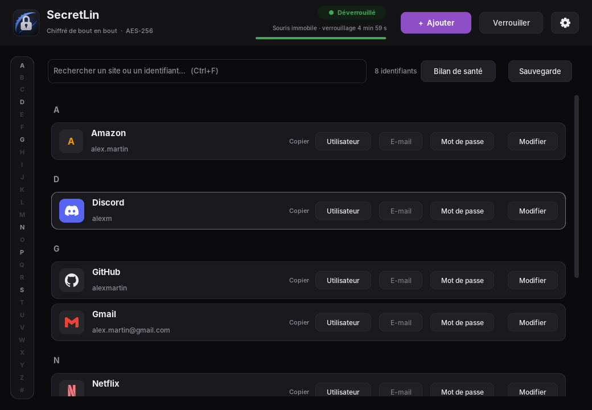
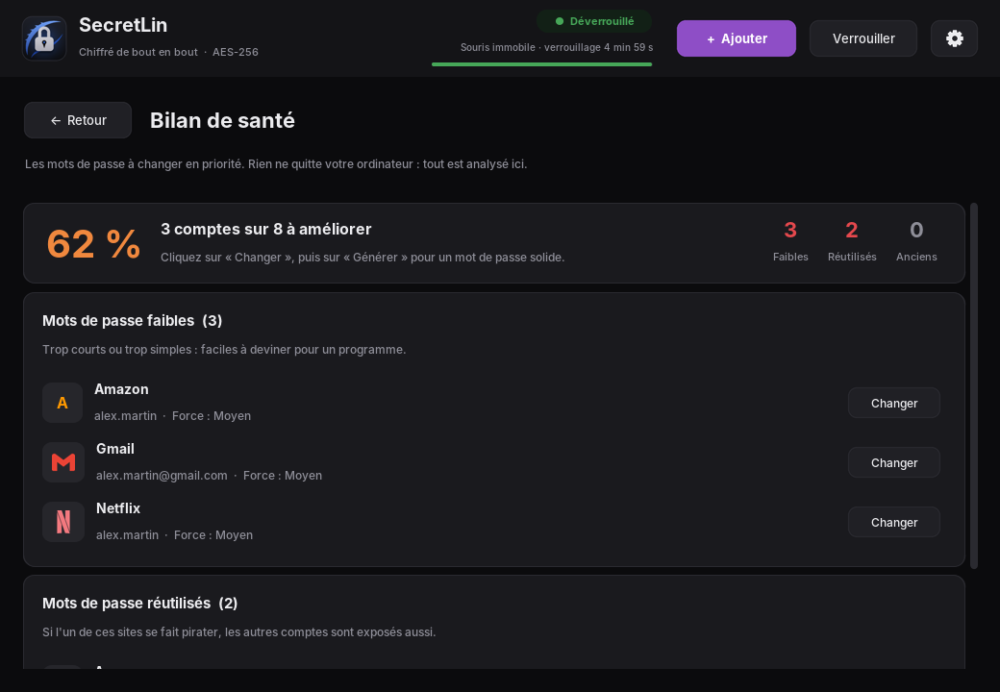
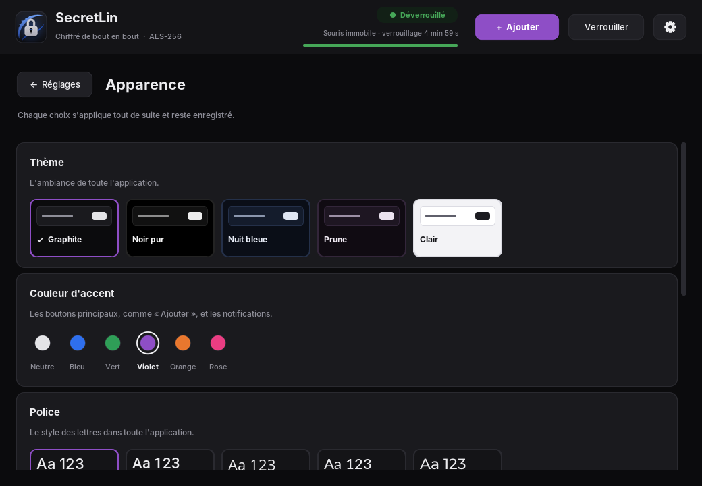
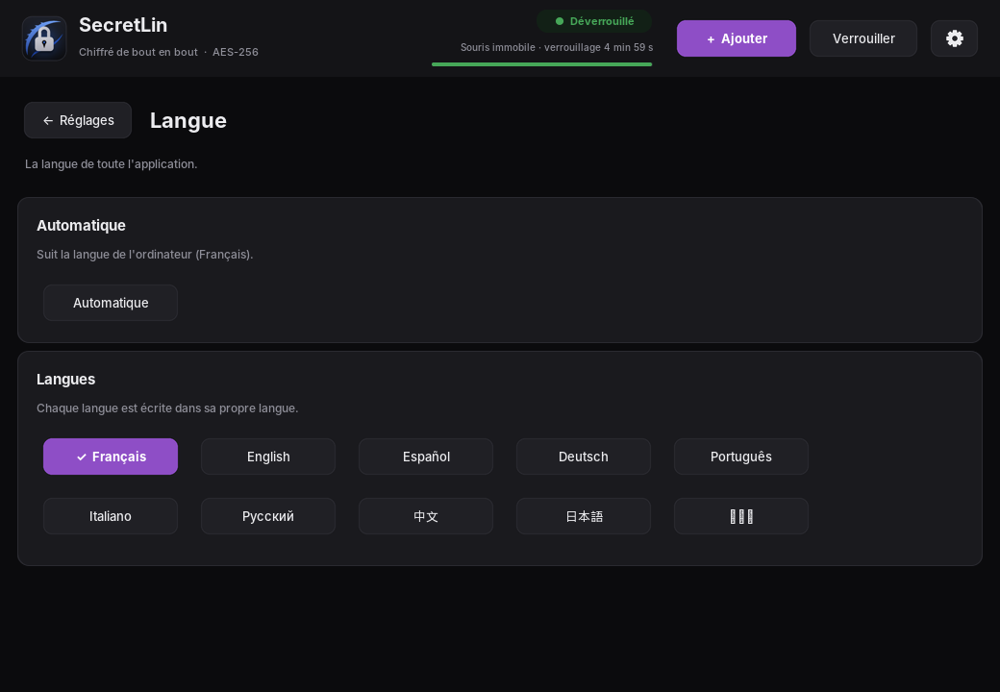

<div align="center">

# 🔐 SecretLin

**Un gestionnaire de mots de passe simple, beau et chiffré, pour Linux.**

🇫🇷 Français · 🇬🇧 [English](README.en.md)

[](https://github.com/peterpan1-sudo/SecretLin/releases/latest)
[](LICENSE)




</div>

SecretLin range tous vos identifiants (site, nom d'utilisateur, e-mail, mot de passe) dans
un **coffre chiffré** sur votre ordinateur. Vous n'avez plus qu'**un seul mot de passe à
retenir** : le mot de passe maître. Rien n'est envoyé sur Internet.

## Sommaire

- [Fonctionnalités](#-fonctionnalités)
- [Installation](#-installation)
- [Premiers pas](#-premiers-pas)
- [Extension de navigateur et remplissage rapide](#-extension-de-navigateur-et-remplissage-rapide)
- [Captures d'écran](#-captures-décran)
- [Sécurité](#-sécurité)
- [Sauvegardes](#-sauvegardes)
- [Questions fréquentes](#-questions-fréquentes)
- [Pour les développeurs](#-pour-les-développeurs)
- [Crédits et licence](#-crédits-et-licence)

## ✨ Fonctionnalités

| | |
|---|---|
| 🔒 **Coffre chiffré** | AES-256-GCM, clé dérivée du mot de passe maître avec Argon2id. |
| 📋 **Copie en un clic** | Nom d'utilisateur, e-mail ou mot de passe ; le presse-papier est vidé au bout de 3 minutes. |
| 🎲 **Générateur** | Mots de passe solides : longueur, majuscules, chiffres, symboles, sans caractères ambigus. |
| 🩺 **Bilan de santé** | Repère les mots de passe faibles, réutilisés ou pas changés depuis plus d'un an, et, en option, ceux apparus dans des fuites de données. |
| 🔑 **Codes 2FA** | Les codes de double authentification à 6 chiffres, comme Google Authenticator. |
| ⭐ **Favoris et catégories** | Comptes favoris en tête de liste, catégories (Jeux, Banque…) et filtre. |
| 🕘 **Historique** | Les 10 derniers mots de passe de chaque compte restent consultables. |
| 🌐 **Extension de navigateur** | Firefox, Chrome, Chromium, Brave, Edge, Vivaldi, Opera : vos comptes proposés sous les champs de connexion. |
| ⚡ **Remplissage rapide** | `Ctrl+Alt+P` partout (même dans une appli comme Discord) : recherche, code PIN, copie. |
| 📦 **Import** | Depuis Firefox, Chrome, Bitwarden, KeePass, 1Password ou LastPass (fichier CSV). |
| 🔎 **Recherche et index A–Z** | Retrouvez un compte en quelques lettres. Logos des sites connus (Discord, Netflix, Steam…). |
| ⏱️ **Verrouillage automatique** | Après 5 min sans bouger la souris sur la fenêtre, ou 2 min avec la souris en dehors. |
| 💾 **Sauvegardes** | Copies automatiques, export et import chiffrés (clé USB, autre disque…). |
| 🎨 **Personnalisable** | 5 thèmes, 6 couleurs, 10 polices, taille du texte, animations. |
| 🌍 **10 langues** | Français, anglais, espagnol, allemand, portugais, italien, russe, chinois, japonais, coréen. |

## 📥 Installation

SecretLin est fait pour **Kali Linux** et **Debian** (paquet `.deb`).

### Première installation

1. Ouvrez la page de la [dernière version](https://github.com/peterpan1-sudo/SecretLin/releases/latest).
2. Téléchargez les **3 fichiers `.deb`** (SecretLin et deux bibliothèques qui ne sont pas dans les dépôts de Kali).
3. Ouvrez un terminal dans le dossier du téléchargement, puis lancez :

   ```bash
   cd ~/Téléchargements
   sudo apt install ./python3-darkdetect_*_all.deb ./python3-customtkinter_*_all.deb ./secretlin_*_all.deb
   ```

4. Lancez SecretLin depuis le **menu des applications**, ou en tapant `secretlin` dans un terminal.

Les polices de l'interface, y compris celles du chinois, du japonais et du coréen, s'installent automatiquement avec SecretLin.

### Mise à jour

La page de chaque version donne une commande prête à copier, par exemple :

```bash
cd /tmp && wget -N https://github.com/peterpan1-sudo/SecretLin/releases/download/v1.2.0/secretlin_1.2.0_all.deb && sudo apt install ./secretlin_1.2.0_all.deb
```

Votre coffre et vos réglages sont conservés.

## 🚀 Premiers pas

1. **Créez votre mot de passe maître** au premier lancement. Choisissez-le long et notez-le
   en lieu sûr : sans lui, le coffre ne peut pas être ouvert.
2. Cliquez sur **« + Ajouter »** pour enregistrer un compte. Le bouton **« Générer »**
   crée un mot de passe solide pour vous.
3. Dans la liste, les boutons **« Copier »** copient le nom d'utilisateur, l'e-mail ou le mot de passe.
4. Ouvrez de temps en temps le **« Bilan de santé »** pour voir les mots de passe à changer.
5. L'engrenage **⚙** ouvre les réglages : sécurité, générateur, apparence et langue.

**Raccourcis clavier :** `Ctrl+N` ajouter · `Ctrl+F` rechercher · `Ctrl+L` verrouiller.

## 🌐 Extension de navigateur et remplissage rapide

**Code PIN.** Dans ⚙ Réglages → Sécurité, choisissez un code à 4 chiffres. Tant que
SecretLin a été déverrouillé avec le mot de passe maître (depuis moins de 8 heures) et
n'a pas été quitté, ce code suffit pour copier ou remplir un identifiant. Trois codes
faux, et le mot de passe maître est redemandé. Avec un code, la croix de la fenêtre laisse
SecretLin en arrière-plan ; « Quitter SecretLin » le ferme vraiment.

**Remplissage rapide.** ⚙ Réglages → Sécurité → « Installer le raccourci » (GNOME et Xfce).
Ensuite, `Ctrl+Alt+P` ouvre une petite fenêtre : tapez le nom du site, Entrée, le code PIN,
puis Entrée copie l'identifiant et encore Entrée le mot de passe.

**Extension.** ⚙ Réglages → Navigateurs guide l'installation :
1. « Installer la connexion » (déjà faite pour Firefox, Chromium, Chrome et Edge par le paquet) ;
2. Chrome, Chromium, Brave, Edge, Vivaldi, Opera : page des extensions → mode développeur →
   « Charger l'extension non empaquetée » → dossier `/usr/share/secretlin/extension` ;
3. Firefox ESR : `about:config` → `xpinstall.signatures.required` à `false`, puis
   « Installer un module depuis un fichier » avec le fichier préparé par SecretLin.

Sur une page de connexion, cliquez dans le champ : les comptes de ce site s'affichent dessous.
Par sécurité, un compte n'est proposé que sur un site au nom identique (pas sur
« amaz.com » pour Amazon), et l'extension ne parle qu'à SecretLin, sur votre ordinateur.

## 📸 Captures d'écran

| Bilan de santé | Apparence |
|---|---|
|  |  |

| Langue | |
|---|---|
|  | |

## 🔒 Sécurité

- Le coffre est chiffré en **AES-256-GCM**. La clé est dérivée du mot de passe maître avec
  **Argon2id**, conçu pour rendre très lentes les attaques par essais successifs.
- Le mot de passe maître **n'est jamais enregistré**, nulle part. Il doit faire au moins
  12 caractères (minuscule, majuscule, chiffre, caractère spécial), et SecretLin vérifie
  qu'il n'apparaît pas dans une fuite de données connue (case décochable).
- **Fichier-clé** en option (⚙ Réglages → Sécurité) : le coffre ne s'ouvre alors qu'avec
  le mot de passe maître **et** un fichier, par exemple sur une clé USB. C'est un deuxième
  facteur : un mot de passe volé ne suffit plus.
- Toute modification du fichier du coffre (par un autre programme, par exemple) est **détectée**.
- Après 3 mauvais essais, il faut attendre 1 min, puis 3, 5, 10, 15, 30 min et 1 h.
  L'attente continue même si l'on ferme et relance SecretLin.
- Le **Bilan de santé** analyse vos mots de passe sur l'ordinateur.
- La vérification des **fuites de données** (Have I Been Pwned) est **désactivée par défaut**.
  Une fois activée, vos mots de passe ne sont toujours pas envoyés : seuls les 5 premiers
  caractères de leur empreinte SHA-1 partent sur Internet, et la comparaison se fait sur
  l'ordinateur (méthode du « k-anonymat »).

## 💾 Sauvegardes

Le coffre est rangé dans `~/.local/share/GestionnaireMDP/coffre.vault`.
SecretLin en garde aussi des copies, toutes chiffrées :

- avant chaque enregistrement : `coffre.vault.bak` ;
- à chaque déverrouillage : une copie datée dans `sauvegardes/` (les 5 plus récentes).

Le bouton **« Sauvegarde »** de l'écran principal permet de :

- **Exporter** le coffre dans un fichier chiffré avec un mot de passe d'export, où vous voulez (clé USB, autre disque…) ;
- **Importer** un tel fichier (les comptes déjà présents ne sont pas ajoutés deux fois) ;
- **Importer depuis un autre gestionnaire** : le fichier CSV exporté par Firefox, Chrome,
  Bitwarden, KeePass, 1Password ou LastPass (catégories, favoris et clés 2FA compris).
  Pensez à supprimer ce fichier ensuite : il contient vos mots de passe en clair ;
- **Restaurer** une copie automatique. L'opération est réversible : le coffre actuel devient la copie « Avant le dernier enregistrement ».

## ❓ Questions fréquentes

**J'ai oublié mon mot de passe maître.**
Il n'existe aucun moyen de le retrouver : c'est ce qui protège vos données. Il faudra
recréer un coffre. Pensez à le noter en lieu sûr.

**Mes mots de passe sont-ils envoyés sur Internet ?**
Non. Tout reste sur votre ordinateur, dans un fichier chiffré. Seule la vérification des
fuites, si vous l'activez, utilise Internet, sans jamais envoyer vos mots de passe.

**Comment passer de Bitwarden (ou Firefox, Chrome…) à SecretLin ?**
Exportez vos mots de passe en CSV depuis l'autre gestionnaire, puis dans SecretLin :
Sauvegarde → Depuis un autre gestionnaire.

**Comment protéger encore plus mon coffre ?**
Activez le fichier-clé : ⚙ Réglages → Sécurité → Créer un fichier-clé, et rangez-le sur
une clé USB. Gardez-en une copie : sans ce fichier, le coffre ne peut plus être ouvert.

**Comment changer mon mot de passe maître ?**
⚙ Réglages → Sécurité. Le coffre et ses copies automatiques sont rechiffrés.

**Comment changer la langue ?**
⚙ Réglages → Langue. Par défaut, SecretLin suit la langue de l'ordinateur.

**Ça marche sous Windows ou macOS ?**
Ce n'est pas testé. Le code devrait fonctionner avec Python (voir ci-dessous), sans garantie.

## 🔧 Pour les développeurs

Lancer depuis le code (Python 3 avec Tkinter) :

```bash
python3 -m venv .venv
.venv/bin/pip install -r requirements.txt
.venv/bin/python lancer.py
```

Sous Windows, remplacez `.venv/bin/` par `.venv\Scripts\`.

| Action | Commande |
|---|---|
| Lancer les tests | `xvfb-run -a .venv/bin/python -m pytest -q` |
| Construire le paquet `.deb` | `dpkg-buildpackage -us -uc -b` (dossier `debian/`) |
| Construire un exécutable unique (Linux) | `./construire.sh` |

Les textes de l'interface sont écrits en français dans le code et traduits dans
`gestionnaire/traductions.json`.

## 📜 Crédits et licence

Les logos des sites proviennent de [Simple Icons](https://simpleicons.org) (licence CC0)
et sont intégrés dans `gestionnaire/logos.zip` : rien n'est téléchargé pendant l'utilisation.
Les marques citées appartiennent à leurs propriétaires respectifs.

SecretLin est distribué sous [licence MIT](LICENSE).
